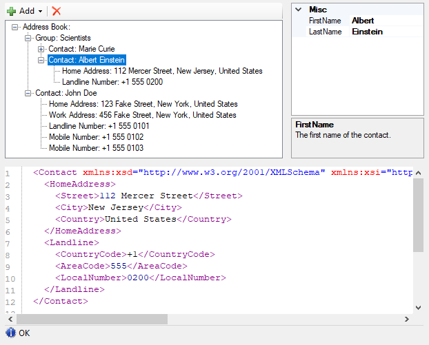

# NanoByte Structure Editor

[](https://github.com/nano-byte/structure-editor/actions/workflows/build.yml)
[](https://www.nuget.org/packages/NanoByte.StructureEditor.WinForms/)
[](https://www.nuget.org/packages/NanoByte.StructureEditor.EtoForms/)
[](https://structure-editor.nano-byte.net/)  
NanoByte Structure Editor is a .NET library that helps you build split-screen editors for your data structures, consisting of:

1. a collapsible tree-view of the data structure,
2. a graphical editor for the currently selected node in the tree (auto-generated or custom) and
3. a text editor with a serialized (e.g., XML or JSON) representation of the currently selected node.

This allows you to create an IDE-like experience for your users when editing complex domain specific languages, configuration files, etc..



## Usage

The library is available for two GUI toolkits. Both share the same API for describing your data structure, storage and undo/redo. Add a reference to the NuGet package matching your application:

|                     | [NanoByte.StructureEditor.WinForms](https://www.nuget.org/packages/NanoByte.StructureEditor.WinForms/) | [NanoByte.StructureEditor.EtoForms](https://www.nuget.org/packages/NanoByte.StructureEditor.EtoForms/) |
| ------------------- | ------------------------------------------------------------------------------------------------------ | ------------------------------------------------------------------------------------------------------ |
| GUI toolkit         | Windows Forms                                                                                          | [Eto.Forms](https://github.com/picoe/Eto)                                                              |
| Platforms           | Windows                                                                                                | Windows, Linux, macOS                                                                                  |
| Frameworks          | .NET Framework 4.5+, .NET 10.0+                                                                        | .NET Framework 4.7.2+, .NET 10.0+                                                                      |
| Default node editor | `PropertyGridNodeEditor<T>`                                                                            | `PropertyEditorNodeEditor<T>`                                                                          |
| Text editor         | [ICSharpCode.TextEditor](https://github.com/nano-byte/ICSharpCode.TextEditor) with syntax highlighting | Plain monospaced text box, replaceable via `TextEditorFactory.Default`                                 |
| Sample              | [`src/Sample.WinForms`](src/Sample.WinForms)                                                           | [`src/Sample.EtoForms`](src/Sample.EtoForms)                                                           |

An Eto.Forms application additionally needs an `Eto.Platform.*` package for each platform it runs on (e.g., `Eto.Platform.Windows`, `Eto.Platform.Gtk`, `Eto.Platform.Mac64`).

The code snippets below work with both packages unless noted otherwise. Import the namespace matching your package (`NanoByte.StructureEditor.WinForms` or `NanoByte.StructureEditor.EtoForms`).

### Initialization

Create an instance of `StructureEditor<T>` and add it to your Form.

WinForms:
```csharp
var editor = new StructureEditor<MyData>();
Controls.Add(editor);
```

Eto.Forms:
```csharp
var editor = new StructureEditor<MyData>();
form.Content = editor;
```

Alternatively, you may want to derive your own class from `StructureEditor<T>`. This lets you keep the description of your data structure in one place and, with WinForms, use the graphical designer in Visual Studio (which does not support generic types) to place the editor on your Form.
```csharp
public class MyDataEditor : StructureEditor<MyData>
{}
```

You need to "describe" your data structure to the editor. You can do this directly after instantiating the editor or in the constructor of your derived class.
- Call `DescribeRoot()` and then use the fluent API provided as a return value to describe the properties on your main data type.
- Call `Describe<TContainer>()` to describe the properties on a data type `TContainer` exposed by another property. You can use multiple calls with different type parameters to describe arbitrarily deep hierarchies.  

The fluent API provides the following methods:
- `.AddProperty()` describes a property.
- `.AddRequiredProperty()` describes a property that cannot be set to `null`.
- `.AddPolymorphicProperty()` describes a polymorphic property. After calling it you chain `.AddElement()` calls for each specific type the property can hold.
- `.AddRequiredPolymorphicProperty()` describes a polymorphic property that cannot be set to `null`.
- `.AddList()` describes a list.
- `.AddPolymorphicList()` describes a polymorphic list. After calling it you need to chain `.AddElement()` calls for each specific type of element the list can hold.

There are numerous overloads for each of these methods, e.g., allowing you to specify a custom editor control for a data type or to keep the auto-generated one.

```csharp
editor.DescribeRoot("Address Book")
      .AddList("Group", x => x.Groups);
editor.Describe<IContactContainer>()
      .AddList("Contact", x => x.Contacts);
editor.Describe<Contact>()
      .AddRequiredProperty("Home Address", x => PropertyPointer.For(() => x.HomeAddress))
      .AddProperty("Work Address", x => PropertyPointer.ForNullable(() => x.WorkAddress))
      .AddPolymorphicList(x => x.PhoneNumbers)
      .AddElement("Landline Number", () => new LandlineNumber())
      .AddElement("Mobile Number", () => new MobileNumber());
```

### Storage

Use the `Open()` method to load an XML file into the editor:
```csharp
editor.Open(CommandManager<AddressBook>.Load(path));
```

Use the `Save()` method on the `CommandManager` property to save the editor's content as an XML file:
```csharp
editor.CommitPendingChanges(); // Eto.Forms only
editor.CommandManager.Save(path);
```

With Eto.Forms, input in a control that still has the focus may not have been applied yet. Call `CommitPendingChanges()` before saving to make sure the latest input is included.

### Serialization formats

The text editor uses XML by default. To use JSON instead, set the `Serializer` property:
```csharp
editor.Serializer = JsonStructureSerializer.Instance; // System.Text.Json, .NET 10.0+ only
```

To load and save files in the same format, use `SerializingCommandManager<T>`. Passing one to `Open()` also sets the editor's `Serializer`:
```csharp
editor.Open(SerializingCommandManager<AddressBook>.Load(path, JsonStructureSerializer.Instance));
editor.CommandManager.Save(path);
```

For Newtonsoft.Json (including on .NET Framework), add a reference to the [NanoByte.StructureEditor.NewtonsoftJson](https://www.nuget.org/packages/NanoByte.StructureEditor.NewtonsoftJson/) NuGet package and use `NewtonsoftJsonStructureSerializer`.

Polymorphic lists and properties need extra attributes or settings to round-trip through JSON. See [Serialization formats](https://structure-editor.nano-byte.net/serialization-formats.html) for details.

### Samples

Take a look at the sample projects for a more complete setup, including custom node editors and undo/redo functionality. Both use the same data model from [`src/Sample`](src/Sample):
- [`src/Sample.WinForms`](src/Sample.WinForms)
- [`src/Sample.EtoForms`](src/Sample.EtoForms)

## Building

The source code is in [`src/`](src/), config for building the API documentation is in [`doc/`](doc/) and generated build artifacts are placed in `artifacts/`. The source code does not contain version numbers. Instead the version is determined during CI using [GitVersion](https://gitversion.net/).

To build install [Visual Studio 2026 v18.0 or newer](https://www.visualstudio.com/downloads/) and run `.\build.ps1`.  
On Linux and macOS you can run `./build.sh` to compile the solution with the .NET SDK. This skips the .NET Framework targets that require Visual Studio, the unit tests (which depend on WinForms) and the documentation.

## Contributing

We welcome contributions to this project such as bug reports, recommendations and pull requests.

This repository contains an [EditorConfig](http://editorconfig.org/) file. Please make sure to use an editor that supports it to ensure consistent code style, file encoding, etc.. For full tooling support for all style and naming conventions consider using JetBrains' [ReSharper](https://www.jetbrains.com/resharper/) or [Rider](https://www.jetbrains.com/rider/) products.
